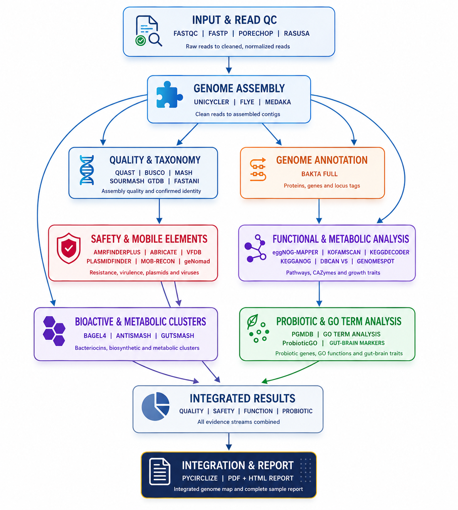
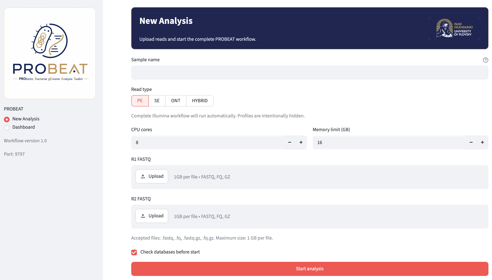
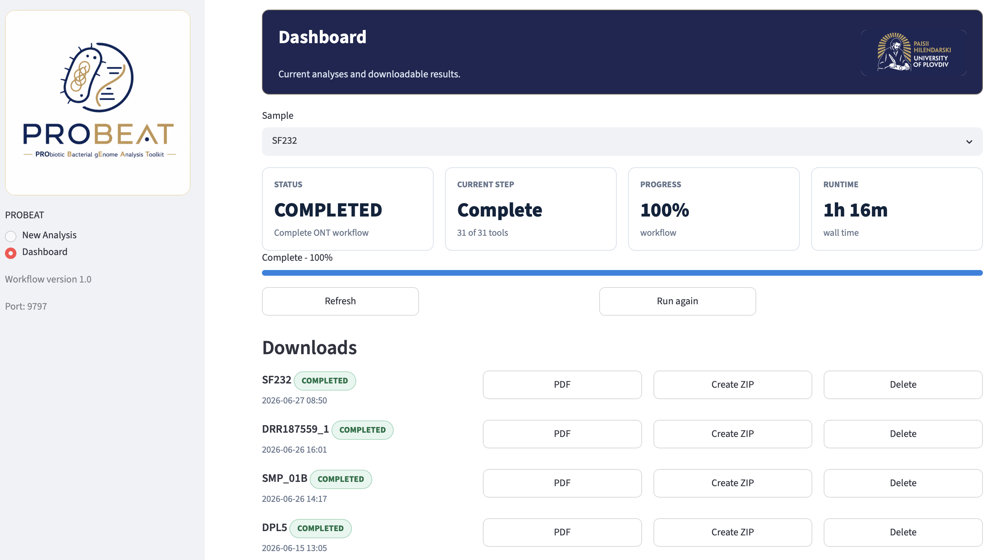

# PROBEAT

<p align="center">
  
</p>

PROBEAT (PRObiotic Bacterial gEnome Analysis Toolkit) is a Dockerized
Snakemake workflow for bacterial isolate genome analysis with a probiotic
interpretation layer, Streamlit web UI, Redis worker, and HTML/PDF reporting.

This repository documents the **full** Docker profile only. The full profile
builds the complete runtime image for Illumina PE/SE, Oxford Nanopore ONT, and
HYBRID analyses.

<p align="center">
  
</p>

<p align="center">
  
</p>

<p align="center">
  
</p>

<p align="center">
  ✨📘 <a href="https://github.com/vebaev/PROBEAT/blob/master/docs/examples/SRR30409709_sample_booklet_report.pdf"><strong>VIEW SAMPLE PDF BOOKLET REPORT</strong></a>✨
</p>

## Workflow Programs

PROBEAT combines FastQC, fastp, Rasusa, Unicycler, Flye, Medaka, QUAST, Mash,
sourmash, BUSCO, Bakta, AMRFinderPlus, ABRicate, KofamScan, KEGGDecoder,
dbCAN, eggNOG-mapper, antiSMASH, gutSMASH, BAGEL4, geNomad, GenomeSPOT,
FastANI, MOB-suite, GOProbioticProfiler, pyCirclize, and custom reporting
scripts to cover QC, assembly, taxonomy, annotation, safety, mobile elements,
functional potential, probiotic markers, comparative genomics, genome maps,
and final HTML/PDF reports.

## Requirements

- Docker Engine with Docker Compose (`docker-compose`)
- Internet access for the first image build and database download
- Sufficient disk space for the full image, workflow outputs, and downloaded
  biological databases (the workflow and databases require about 200 GB of disk space)
- Linux server or workstation recommended for production runs

The databases are not stored in Git and are not baked into the image. They are
downloaded into `./storage/databases` by the `database-init` Compose service.

Largest database groups:

- `bakta_full`: `84G`
- `eggnog`: `59G`
- `antismash`: `9.4G`
- `dbcan_v5`: `7.4G`
- `kofam`: `7.2G`
- `gutsmash`: `3.8G`

Medium-sized database groups:

- `mob_suite`: `2.9G`
- `sourmash`: `2.9G`
- `dbcan`: `2.3G`
- `fastani_ncbi`: `1.8G`
- `genomad`: `1.4G`

## Quickstart

Clone the repository:

```bash
git clone https://github.com/vebaev/PROBEAT.git
cd PROBEAT
```

Create the local environment file:

```bash
cp .env.example .env
```

Build the full Docker image:

```bash
docker build --build-arg INSTALL_PROFILE=full -t probeat:full .
```

Download all required databases:

```bash
docker-compose run --rm database-init
```

Verify the downloaded databases:

```bash
docker-compose run --rm database-manager
```

Start the application stack:

```bash
docker-compose up -d redis worker streamlit
```

Check that the web UI is healthy:

```bash
curl http://localhost:9797/_stcore/health
```

Open the interface:

```text
http://localhost:9797
```

## Validate Installation

Run the full runtime doctor:

```bash
docker-compose run --rm worker ./probeat doctor --profile full --strict
```

Run a Snakemake dry-run with the bundled smoke FASTQ:

```bash
docker-compose run --rm worker \
  workflow/run_sample.sh SMOKE_SE SE tests/data/smoke.fastq \
  --dry-run --cores 2
```

## Data Locations

The default `.env.example` keeps runtime data under `./storage`:

- `./storage/uploads`: uploaded FASTQ files
- `./storage/results`: workflow outputs and reports
- `./storage/databases`: downloaded biological databases
- `./storage/logs`: workflow and service logs
- `./storage/state`: job state files

These directories are intentionally ignored by Git.

## Troubleshooting

Check container status:

```bash
docker-compose ps
```

Check Streamlit logs:

```bash
docker logs --tail=120 probeat-streamlit-1
```

Check worker logs:

```bash
docker logs --tail=120 probeat-worker-1
```

Re-run database verification:

```bash
docker-compose run --rm database-manager
```

If a workflow step fails, inspect:

```text
storage/results/<sample>/run/probeat.log
storage/logs/
```

## License

See [LICENSE](LICENSE).

## Citation

See [CITATION.cff](CITATION.cff).
